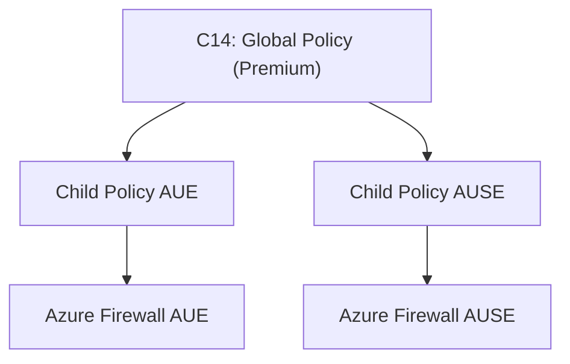

# C14 — Firewall Global Policy

## Overview

Creates a centralised Azure Firewall Policy (global/parent) with DNS proxy, threat intelligence, and optional IDPS (intrusion detection) for Premium SKU. This is the root policy that child/environment-specific policies inherit from in the policy hierarchy.

**Module path:** `modules/Connectivity/C14-firewall-global-policy/`

## Architecture



## Resources Created

| Resource | Mode | Description |
|----------|------|-------------|
| `azurerm_firewall_policy.this` | 1 | Global Azure Firewall Policy |

## Inputs

| Variable | Type | Default | Description |
|----------|------|---------|-------------|
| `name` | `string` | (required) | Firewall policy name |
| `resource_group_name` | `string` | (required) | Resource group |
| `location` | `string` | `var.default_location` | Region |
| `sku` | `string` | `"Premium"` | Firewall SKU (Premium enables IDPS) |
| `threat_intelligence_mode` | `string` | `"Alert"` | Alert or Deny mode |
| `auto_learn_private_ranges_enabled` | `bool` | `true` | Auto-learn private ranges |
| `dns_proxy_enabled` | `bool` | `true` | DNS proxy for Private DNS resolution |
| `base_policy_id` | `string` | `null` | Parent policy ID for hierarchy |
| `idps_mode` | `string` | `"Alert"` | IDPS mode: Alert, Deny, or Off |
| `tags` | `map(string)` | `{}` | Tags |

## Outputs

| Output | Description |
|--------|-------------|
| `id` | Firewall policy resource ID |
| `name` | Firewall policy name |

## How to Use in the Orchestrator

C14 is instantiated **three times** to build a policy hierarchy: Global → Child AUE → Child AUSE (secondary region).

```hcl
# ── Global Parent Policy ──
module "firewall_global_policy" {
  source = "git::https://github.com/samirbelkessa/Landing-Zone.git//Terraform-Azure-LZ/modules/Connectivity/C14-firewall-global-policy"

  name                     = local.connectivity_naming.firewall_policy_global
  resource_group_name      = try(module.l01-subscription-vending-v2.resource_groups_by_subscription["connectivity"]["network-aue"].name)
  location                 = var.default_location
  sku                      = var.firewall_sku_tier           # "Premium"
  threat_intelligence_mode = var.firewall_threat_intel_mode   # "Alert"
  idps_mode                = var.firewall_idps_mode           # "Alert"
  count                    = var.deploy_connectivity ? 1 : 0
  tags                     = local.connectivity_tags

  depends_on = [module.l01-subscription-vending-v2]
  providers  = { azurerm = azurerm.connectivity }
}

# ── Child Policy AUE (Primary Region) ──
module "firewall_child_policy_aue" {
  source = "git::https://github.com/samirbelkessa/Landing-Zone.git//Terraform-Azure-LZ/modules/Connectivity/C14-firewall-global-policy?ref=main"

  name                              = local.connectivity_naming.firewall_policy_aue
  resource_group_name               = try(module.l01-subscription-vending-v2.resource_groups_by_subscription["connectivity"]["network-aue"].name)
  location                          = var.default_location
  sku                               = var.firewall_sku_tier
  base_policy_id                    = module.firewall_global_policy[0].id    # Inherits from global
  dns_proxy_enabled                 = true
  auto_learn_private_ranges_enabled = true
  threat_intelligence_mode          = var.firewall_threat_intel_mode
  idps_mode                         = var.firewall_idps_mode
  count                             = var.deploy_connectivity ? 1 : 0
  tags                              = local.connectivity_tags

  depends_on = [module.firewall_global_policy]
  providers  = { azurerm = azurerm.connectivity }
}

# ── Child Policy AUSE (Secondary Region) ──
module "firewall_child_policy_ause" {
  source = "git::https://github.com/samirbelkessa/Landing-Zone.git//Terraform-Azure-LZ/modules/Connectivity/C14-firewall-global-policy?ref=HEAD"

  name            = local.connectivity_naming.firewall_policy_ause
  base_policy_id  = module.firewall_global_policy[0].id    # Inherits from global
  count           = var.deploy_connectivity && var.enable_secondary_region ? 1 : 0
  # ... same pattern as AUE

  depends_on = [module.firewall_global_policy, time_sleep.wait_for_global_policy]
  providers  = { azurerm = azurerm.connectivity }
}
```

### Options Guide

| Option | When to change | Impact |
|--------|---------------|--------|
| `sku = "Standard"` | Cost savings (no IDPS) | Disables intrusion detection |
| `sku = "Premium"` | Full security (IDPS + TLS inspection) | Enables IDPS dynamic block |
| `threat_intelligence_mode = "Deny"` | Block known malicious IPs | Active blocking vs alert-only |
| `idps_mode = "Deny"` | Block detected intrusions | Active blocking vs alert-only |
| `dns_proxy_enabled = true` | Spoke DNS resolution | Required for Private DNS zones through firewall |
| `base_policy_id = "..."` | Create child policy | Inherits rules from parent policy |
| `enable_secondary_region = false` | Single region | Skips AUSE child policy |

## Dependencies

- **Upstream:** None
- **Downstream:** AVM Connectivity module (child policies inherit), ClientLZ (firewall rule collection groups)

## Implementation Notes

- **Very lean module** — single resource with focused purpose
- **IDPS conditional:** Only deployed when `sku == "Premium"` via dynamic block
- **DNS proxy critical** for spoke VNets to resolve Private DNS zones through the firewall
- **Policy hierarchy** via `base_policy_id` for inherited policies
