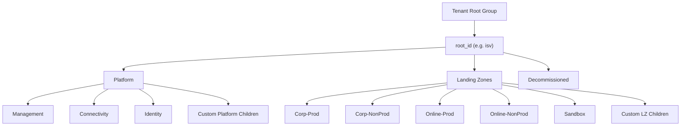

# F01 — Management Groups

## Overview

Deploys the Azure Management Group hierarchy following the Microsoft Cloud Adoption Framework (CAF) enterprise-scale design. Creates a tree structure from an intermediate root management group branching into **Platform**, **Landing Zones**, and **Decommissioned** segments. Landing Zones supports two archetypes (Corp and Online), each optionally split into Prod/NonProd sub-groups.

**Module path:** `modules/Fondations/F01-management-groups/`

## Architecture



## Resources Created

| Resource | Mode | Description |
|----------|------|-------------|
| `azurerm_management_group.root` | 1 (always) | Root intermediate MG |
| `azurerm_management_group.platform` | count 0–1 | Platform parent MG |
| `azurerm_management_group.management` | count 0–1 | Management child (under Platform) |
| `azurerm_management_group.connectivity` | count 0–1 | Connectivity child (under Platform) |
| `azurerm_management_group.identity` | count 0–1 | Identity child (under Platform) |
| `azurerm_management_group.custom_platform` | for_each | Custom platform MGs |
| `azurerm_management_group.landing_zones` | count 0–1 | Landing Zones parent MG |
| `azurerm_management_group.corp_prod` | count 0–1 | Corp-Prod MG |
| `azurerm_management_group.corp_nonprod` | count 0–1 | Corp-NonProd MG |
| `azurerm_management_group.corp` | count 0–1 | Corp single MG (no prod/nonprod split) |
| `azurerm_management_group.online_prod` | count 0–1 | Online-Prod MG |
| `azurerm_management_group.online_nonprod` | count 0–1 | Online-NonProd MG |
| `azurerm_management_group.online` | count 0–1 | Online single MG (no prod/nonprod split) |
| `azurerm_management_group.sandbox` | count 0–1 | Sandbox MG |
| `azurerm_management_group.decommissioned` | count 0–1 | Decommissioned MG |
| `azurerm_management_group.custom_landing_zone` | for_each | Custom LZ child MGs |
| `azurerm_management_group_subscription_association` | for_each | Subscription-to-MG placement |

## Inputs

### Required

| Variable | Type | Description |
|----------|------|-------------|
| `root_name` | `string` | Display name for root MG (organisation name) |
| `root_id` | `string` | ID/Name for root MG, used as naming prefix |
| `root_parent_id` | `string` | Tenant Root Group ID or parent MG ID |

### Optional — Deployment Flags

| Variable | Type | Default | Description |
|----------|------|---------|-------------|
| `deploy_platform_mg` | `bool` | `true` | Deploy Platform MG and children |
| `deploy_landing_zones_mg` | `bool` | `true` | Deploy Landing Zones MG and children |
| `deploy_decommissioned_mg` | `bool` | `true` | Deploy Decommissioned MG |
| `deploy_sandbox_mg` | `bool` | `true` | Deploy Sandbox under Landing Zones |
| `deploy_corp_landing_zones` | `bool` | `true` | Deploy Corp archetype MGs |
| `deploy_online_landing_zones` | `bool` | `true` | Deploy Online archetype MGs |
| `deploy_prod_nonprod_separation` | `bool` | `true` | Create separate Prod/NonProd MGs per archetype |

### Optional — Extensions

| Variable | Type | Default | Description |
|----------|------|---------|-------------|
| `custom_landing_zone_children` | `map(object)` | `{}` | Additional custom LZ child MGs |
| `custom_platform_children` | `map(object)` | `{}` | Additional custom Platform child MGs |
| `subscription_ids_by_mg` | `map(list(string))` | `{}` | Subscription-to-MG associations |
| `timeouts` | `object` | 30m/5m/30m/30m | Timeout configuration for CRUD operations |

## Outputs

| Output | Description |
|--------|-------------|
| `root_mg_id` / `root_mg_name` | Root MG identifiers |
| `platform_mg_id` / `management_mg_id` / `connectivity_mg_id` / `identity_mg_id` | Platform children IDs |
| `landing_zones_mg_id` / `corp_prod_mg_id` / `corp_nonprod_mg_id` / `online_prod_mg_id` / `online_nonprod_mg_id` | LZ archetype IDs |
| `sandbox_mg_id` / `decommissioned_mg_id` | Sandbox and Decommissioned MG IDs |
| `all_mg_ids` | Map of all MG names to IDs |
| `archetype_mg_ids` | Map of archetypes to MG IDs (for G03 policy assignment) |
| `hierarchy` | Nested structure for visualisation |

## How to Use in the Orchestrator

This is the **first module deployed**. All deployment flags are exposed as variables in `terraform.tfvars`.

```hcl
module "management_groups" {
  source = "git::https://github.com/samirbelkessa/Landing-Zone//Terraform-Azure-LZ/modules/Fondations/F01-management-groups?ref=main"

  # ── Required ──
  root_parent_id = var.root_parent_id   # Tenant Root Group GUID
  root_name      = var.root_name         # e.g. "ISV Landing Zone"
  root_id        = var.root_id           # e.g. "isv"

  # ── Deployment flags (all default to true) ──
  deploy_platform_mg             = var.deploy_platform_mg
  deploy_landing_zones_mg        = var.deploy_landing_zones_mg
  deploy_decommissioned_mg       = var.deploy_decommissioned_mg
  deploy_sandbox_mg              = var.deploy_sandbox_mg
  deploy_corp_landing_zones      = var.deploy_corp_landing_zones
  deploy_online_landing_zones    = var.deploy_online_landing_zones
  deploy_prod_nonprod_separation = var.deploy_prod_nonprod_separation

  # ── Optional extensions ──
  custom_platform_children     = var.custom_platform_children       # {} = none
  custom_landing_zone_children = var.custom_landing_zone_children   # {} = none
  subscription_ids_by_mg       = var.subscription_ids_by_mg         # {} = none
  timeouts                     = var.timeouts
  default_location             = var.default_location
}
```

### Options Guide

| Option | When to change | Impact |
|--------|---------------|--------|
| `deploy_prod_nonprod_separation = false` | Small deployments, single env per archetype | Creates Corp/Online instead of Corp-Prod + Corp-NonProd |
| `deploy_sandbox_mg = false` | No sandbox/experimentation needed | Removes Sandbox MG |
| `deploy_corp_landing_zones = false` | Online-only (no internal workloads) | Removes Corp archetype entirely |
| `custom_platform_children` | Need additional platform MGs (e.g. "Security") | Adds custom children under Platform |
| `subscription_ids_by_mg` | Place existing subscriptions at deployment time | Associates subs to MGs |

## Dependencies

- **Upstream:** None — this is the first module deployed
- **Downstream:** G01–G04 (policy scope), G03 (archetype MG IDs for assignment), L01 (MG placement)

## Implementation Notes

- **Mutually exclusive creation:** When `deploy_prod_nonprod_separation = true`, separate Corp-Prod/Corp-NonProd are created; when `false`, a single Corp MG is created instead
- **Naming convention:** All MG names prefixed with `root_id` (e.g. `isv-platform`, `isv-corp-prod`)
- **Lifecycle:** All MGs use `ignore_changes = [subscription_ids]` to prevent fights with external subscription placement
- **Parent ID normalisation:** Handles both bare GUIDs and full ARM resource ID formats
